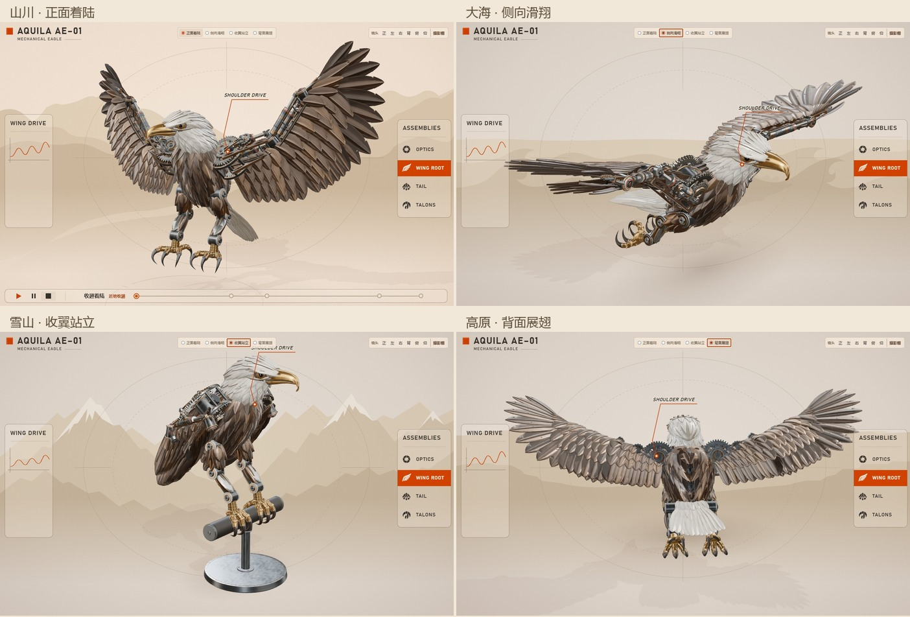

# Aquila AE-01 · 机械白头海雕

一个可以旋转、缩放和检视机械结构的 WebGL 2 展品。正面着陆演示一次 **4 秒**的连续动作。机械鹰在低空扇翅两次，随后收翅、落爪并屈腿缓冲。侧向滑翔、收翼站立和背面展翅各有对应的风景剪影。

[打开在线展品](https://awak3n1ngone.github.io/aquila-ae01/) · [观看着陆短片](https://awak3n1ngone.github.io/aquila-ae01/aquila-landing.mp4)



## 本地运行

从项目根目录还原模型并启动静态服务，再打开 `http://127.0.0.1:8000/`。运行展品需要支持 WebGL 2 的浏览器。

```sh
node prepare-assets.mjs
python -m http.server 8000 --bind 127.0.0.1 --directory dist
```

如需双击打开的单文件版本，可以用 Node.js 打包。

```sh
node build-offline.mjs aquila-ae01-offline.html
```

## 源码与模型

- `dist/` 包含用于部署的网页和展示素材。运行 `node prepare-assets.mjs` 后，压缩 GLB 会出现在 `dist/assets/`。
- `blender/` 包含几何、材质、动作烘焙和模型导出脚本。
- 可编辑场景还原到 `model/Aquila-Landing.blend` 后可用 Blender 5.2.2 打开。它包含模型、棚灯、镜头和着陆关键帧，原始数据保存在 `model/parts/`，还原时会校验 SHA-256。

在项目根目录运行以下命令可以重新生成 Blender 场景和网页模型。脚本同步更新 `dist/assets/` 中的 GLB、骨架参数和棚灯贴图。

```sh
blender -b --factory-startup -P blender/build.py -- --output ./local-build --prepare
```

向 `main` 分支推送后，GitHub Actions 会将 `dist/` 部署到 GitHub Pages。

## 许可

本项目原创源码、模型与展示素材采用 [MIT](LICENSE) 许可。随附的 Three.js 和 fflate 保留各自的 [第三方许可声明](dist/assets/THIRD-PARTY-NOTICES.txt)。
